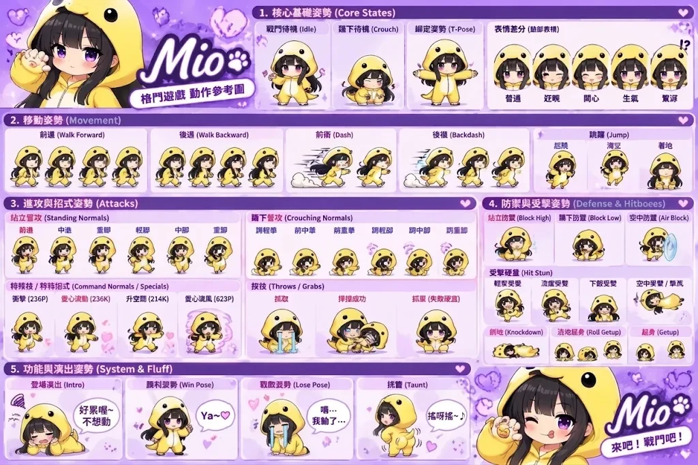

# 角色設定書：Mio

## 1. 基本設定

| 項目 | 內容 |
|---|---|
| 名字 | Mio |
| 個性 | 撲克臉、慵懶，什麼都嫌累 |
| 造型 | 黑長髮、紫眼，穿黃色小恐龍連帽睡衣 |
| 美術 | 像素風 Q 版（與 Sawa 同規格） |
| 戰鬥定位 | **一般型**：各項數值都是標準值；靠長距離的鞭子，加上必殺技變身翻盤 |

## 2. 數值（標準值，M1 原型時再調）

| 數值 | 一般形態 | 恐龍形態（必殺技後 20 秒） |
|---|---|---|
| 血量 | 1000 | 不變 |
| 攻擊力 | 1.0 倍 | **1.5 倍** |
| 受到的傷害 | 1.0 倍 | **0.75 倍**（比較耐打） |
| 前走速度 | 1.0 | **0.7 倍** |
| 衝刺 / 後撤 | 標準 | 不能衝刺 |
| 跳躍 | 標準 | 較低、較慢 |

## 3. 招式表

按鍵與 Sawa 相同：U 輕拳 / I 重拳 / J 輕腳 / K 重腳 / L 特殊 / T 挑釁。

### 一般技
與 Sawa 相同的結構：站立 4 招、蹲下 4 招（蹲輕腳打下段、蹲重腳擊倒）、空中拳腳、投技（→ + I + K）。
Mio 的出招速度是標準值（輕攻擊約 4–5 影格）。

### 特殊技：鞭擊
| 項目 | 內容 |
|---|---|
| 輸入 | L（**扣 1 格鬥氣**） |
| 動作 | 拿出鞭子往前抽 |
| 距離 | 約站重腳的 **2 倍**（鞭尖最遠 280 像素），是 Mio 打得最遠的招 |
| 代價 | 出招較慢、收招破綻大，被對手近身閃過會被反打 【預設，可改】 |
| 用法 | 中距離牽制；也可以由重拳、重腳取消接出 |

> 鞭子打得遠，這幾格動畫的畫布需要加寬到 256 × 128。

### 必殺技：變身恐龍（暫名）
- **輸入**：能量滿格時 L + K 同按。
- **演出**：畫面暫停 + Mio 特寫 → 戴上恐龍頭套 → 「噗」一聲變成圓滾滾的黃色小恐龍。
- **變身期間無敵、不造成傷害**，是純增強型必殺技。
- **效果持續 20 秒**：攻擊力 ×1.5、受到的傷害 ×0.75、移動速度 ×0.7、不能衝刺；畫面上顯示倒數。
- 時間到時「噗」一聲變回 Mio。
- 變身期間能量不累積 【預設，可改】。

#### 恐龍形態（奶龍）的招式
| 招式 | 輸入 | 說明 |
|---|---|---|
| 奶龍拳 | 輕拳（U） | 單手握拳往前揍，發生快 |
| 雙拳重擊 | 重拳（I） | 雙手握拳由上往前砸，擊退大 |
| 肚子撞 | 輕腳（J） | 抱著肚子往前撞，會往前移動 |
| 尾巴橫掃 | 重腳（K） | 轉身用尾巴往前低掃，擊倒 |
| 龍之吐息 | 特殊技（L） | 從嘴巴往前噴火，連打 4 下；**用一次扣 3 格鬥氣** |
| 防禦 / 跳 / 受擊 | 同一般 | 用恐龍形態的專屬動畫 |

- 恐龍形態不能蹲、不能投技、不能空中攻擊（按了不會有反應），只用上表的精簡招式組。

#### 恐龍造型（原創）
- **方向**：黃色、圓滾滾、白肚子、小短手和短尾巴，看起來軟軟的、表情呆呆的；以 Mio 睡衣上的恐龍帽為基礎延伸設計。
- **注意**：不能直接照抄「奶龍」的造型與名字。你提供的奶龍圖片只當「感覺參考」，**不放進專案素材**；最後的造型要有 Mio 自己的特徵（例如帽子上的眼睛、睡衣的紫色細節、慵懶的半閉眼）。
- 名字待定（暫名「Mio 龍」）。

### 挑釁
- **T 鍵**，純表演無遊戲效果。
- 動作照參考圖：轉身翹屁股，左右搖恐龍尾巴，頭上冒出「打我呀！笨蛋～♪」。

## 4. 演出畫面

| 時機 | 動作 | 對話框 |
|---|---|---|
| 出場 | 趴在地上懶得動，然後慢慢爬起來 | 好累喔～不想動 |
| 勝利 | 比 Ya 手勢（臉還是沒表情） | Ya～ |
| 戰敗 | 坐在地上哭 | 嗚…我輸了… |
| 挑釁 | 搖尾巴 | 打我呀！笨蛋～♪ |

（對話框都依參考圖的文字，由遊戲 UI 顯示。）

## 5. 參考圖評估

**可以直接用的**
- 造型和配色統一，連帽睡衣的剪影辨識度高，和 Sawa 的粉紅色系對比很明顯。
- 左上與右下的大張插圖 → 選角畫面、VS 畫面。
- 表情差分 → 血條旁頭像。

**要注意的**
- 和 Sawa 一樣是設定圖：每個動作格數不夠、大小位置不一、背景文字混在一起，需要依規格重新生成。
- **表情**：參考圖很多格是笑臉，但 Mio 是撲克臉。生成時要指定「沒有表情、半閉的想睡眼睛」，只在勝利、戰敗、受擊時才有表情變化。
- 有幾格角色面朝左或正面，需要統一成面朝右。

**參考圖上還缺的**
- 鞭擊動作與鞭子
- 戴頭套變身、變回來的動作
- 整套恐龍形態動畫
- 空中攻擊

## 6. 影格規格

與 Sawa 相同（見 [Sawa 設定書第 6 節](../sawa/sawa.md)），差別：
- 鞭擊用 256 × 128 的寬畫布。
- 恐龍形態體型較圓，畫布仍是 128 × 128，腳底位置不變。
- 生成提示詞加上：「expressionless, sleepy half-closed eyes, yellow dinosaur hoodie」。

## 7. 動畫清單與格數

| 類別 | 動作（建議格數） |
|---|---|
| 基本 | 待機 6（偶爾打哈欠）、蹲下 2、蹲待機 4 |
| 移動 | 前走 6、後走 6、前衝 4、後撤 4、起跳 2、空中 2、落地 2 |
| 站立一般技 | 輕拳 4、重拳 6、輕腳 4、重腳 6 |
| 蹲下一般技 | 輕拳 4、重拳 6、輕腳 4、重腳 6 |
| 空中一般技 | 拳 4、腳 4 |
| 投技 | 抓取 3、摔投 6、抓空 3 |
| 特殊技 | 鞭擊 7（寬畫布） |
| 必殺技 | 戴頭套變身 8、變回來 4 |
| 防禦 | 站防 2、蹲防 2、空防 2 |
| 受擊 | 輕受擊 2、重受擊 3、蹲受擊 2、擊飛 4、倒地 3、起身 4、滾地起身 5 |
| 演出 | 登場 6、勝利 6、戰敗 6、挑釁 6 |
| **恐龍形態** | 待機 6、走 6、起跳 / 空中 / 落地 各 2、防禦 2、受擊 3、小爪拍 4、肚子撞 6、尾巴橫掃 6、倒地 3、起身 4 |
| 特效（另外的圖） | 鞭子殘影 3、變身煙霧 5、打擊火花與防禦火花（與 Sawa 共用） |

**一般形態約 170 格 + 恐龍形態約 46 格 = 約 215 格**（不含特效）。

第一批（約 90 格）與 Sawa 相同的最小集合，特殊技換成鞭擊。

## 8. 待確認

- 恐龍形態的名字與最終造型。
