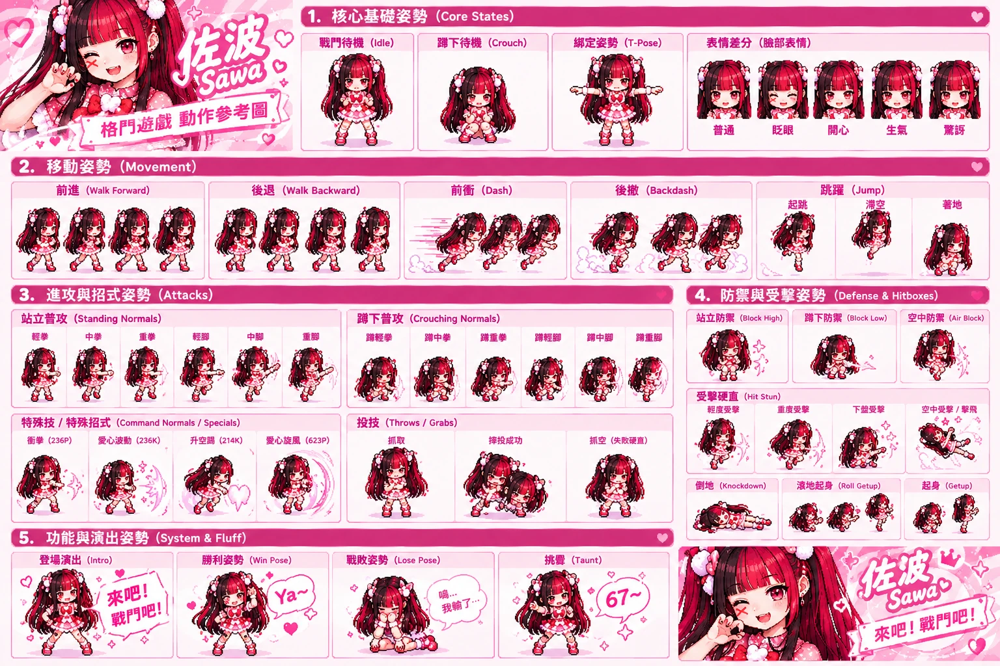

# 角色設定書：佐波 Sawa

## 1. 基本設定

| 項目 | 內容 |
|---|---|
| 名字 | 佐波 Sawa |
| 風格 | 可愛甜美、偶像系；粉紅 × 紅黑雙色長髮、蝴蝶結、毛球髮飾 |
| 美術 | 像素風 Q 版（約 2.5 頭身） |
| 戰鬥定位 | **速度型**：移動快、出招快、連段多；血量低、攻擊距離短 |

## 2. 數值方向（初版，M1 原型時再調）

| 數值 | Sawa | 標準角色參考 |
|---|---|---|
| 血量 | 900 | 1000 |
| 前走速度 | 1.3 倍 | 1.0 |
| 衝刺 | 距離短、速度快、收招短 | — |
| 跳躍 | 較快落地 | — |
| 輕攻擊發生 | 3–4 影格 | 4–5 影格 |
| 攻擊距離 | 短 | 中 |

## 3. 招式表（4 鍵 + 簡化指令）

按鍵：U 輕拳 / I 重拳 / J 輕腳 / K 重腳 / L 特殊 / T 挑釁（**【預設，可改】**）

### 一般技
| 招式 | 輸入 | 說明 |
|---|---|---|
| 站輕拳 / 站重拳 | U / I | 輕拳可連打，重拳可取消成特殊技 |
| 站輕腳 / 站重腳 | J / K | 重腳距離最長 |
| 蹲輕拳 / 蹲重拳 | ↓ + U / I | 蹲重拳可對空 |
| 蹲輕腳 / 蹲重腳 | ↓ + J / K | 蹲輕腳打下段（必須蹲防）；蹲重腳掃腿擊倒 |
| 空中拳 / 空中腳 | 跳躍中 U / J | 需新增美術（參考圖上沒有） |
| 投技 | 靠近 → + I + K 同按 | 抓住後摔投；沒抓到有收招破綻 |

### 特殊技
| 招式 | 輸入 | 定位 |
|---|---|---|
| 愛心波動 | L | 飛行道具，牽制用；可由重拳、重腳取消接出；**扣 1 格鬥氣** |

> Sawa 只有這一招特殊技，所以打空中的對手要靠蹲重拳，被壓著打時沒有無敵反擊招，只能防禦或後撤。這也符合「速度快、但比較脆」的定位。

### 必殺技：偶像演唱會（暫名）
- **輸入**：能量滿格時 L + K 同按。
- **演出**：畫面暫停 + 暗場 + Sawa 特寫 → 拿出麥克風唱歌 → 音符與音波擴散到整個畫面。
- **判定**：**全畫面**，音波打多段，總傷害約對手血量 25–30%。
- **可被格擋**：對手在演出結束時處於防禦狀態就能擋下，**格擋不扣血** 【預設，可改】。
- **平衡設計**：暗場演出後有幾格反應時間才發生判定，讓對手有機會防禦；只有出招中、收招中被打到才吃得到。

### 挑釁「67～」
- **T 鍵**，純表演無遊戲效果。
- **動作**：雙手往兩側攤開、掌心朝上，像秤一樣左右手一上一下交替擺動（左上右下 → 右上左下），重複約 2 輪。
- **對話框**：動作開始時頭上冒出「67～」，動作結束時消失。
- **美術**：建議 8 格（攤手 2 格 + 擺動循環 4 格 + 收手 2 格），表情用參考圖的「普通」或「開心」臉。
- **動作參考**：[taunt-67-reference.png](taunt-67-reference.png)（火柴人示意圖）。

## 4. 演出畫面

| 時機 | 動作 | 對話框（由遊戲 UI 顯示，不畫進圖裡） |
|---|---|---|
| 出場 | 參考圖「登場演出」姿勢 | 來吧！戰鬥吧！ |
| 勝利 | 比 Ya 手勢 | Ya~ |
| 戰敗 | 跪地哭泣 | 嗚…我輸了… |
| 挑釁 | 雙手掌心朝上，一上一下交替擺動 | 67～ |

> 對話框用遊戲內 UI 繪製（字清楚、可改字、可做多語系），不要畫在角色圖上。

## 5. 參考圖評估

**可以直接用的**
- 角色造型、配色、像素風格非常統一，是很好的「角色基準」。
- 左上與右下的大張半身插圖 → 可直接用在角色選擇畫面、VS 對戰前畫面。
- 表情差分（普通 / 眨眼 / 開心 / 生氣 / 驚訝）→ 可用在血條旁的頭像。
- 參考圖已經涵蓋大部分需要的動作種類。

**不能直接當遊戲素材的原因**
這張是「設定參考圖」，不是遊戲用的 Sprite Sheet：
1. 每個動作只有 1–4 格，遊戲需要 3–10 格才會動得順。
2. 每格大小、位置、腳的高度都不一樣，放進遊戲會抖動。
3. 粉紅背景、特效、文字標籤和角色畫在一起，要分開。
4. 有些格子角色朝向不一致。

**參考圖上還缺的**
- 空中攻擊（拳、腳）
- 必殺技：拿麥克風唱歌的動作
- 特效要另外分開的圖：愛心波動飛行道具、音符、音波、打擊火花
- 被投技抓住時的受擊動作（可共用受擊動作替代）

## 6. 給 AI 生成的影格規格（製作說明）

| 項目 | 規格 |
|---|---|
| 單格畫布 | 128 × 128 像素（角色本體約 96–110 像素高） |
| 背景 | 透明，或純綠 #00FF00（方便自動去背） |
| 朝向 | 一律面朝右（遊戲裡自動左右翻轉） |
| 腳底位置 | 雙腳固定踩在畫布同一條水平線上（建議距底部 8 像素） |
| 特效 | 角色和特效分開輸出 |
| 檔名 | `動作名_編號.png`，例如 `idle_01.png`、`walk_f_03.png` |
| 遊戲顯示 | 整數放大 2 倍、保持像素銳利（不模糊） |

> 生成技巧：每次都附上參考圖，並在提示詞裡固定寫「same character, pixel art, chibi, facing right, full body, transparent background, 128x128」，盡量讓每格長得一樣。腳底對齊和小幅誤差交給編輯工具修正。

## 7. 動畫清單與格數（製作清單）

| 類別 | 動作（建議格數） |
|---|---|
| 基本 | 待機 6、蹲下 2、蹲待機 4 |
| 移動 | 前走 6、後走 6、前衝 4、後撤 4、起跳 2、空中 2、落地 2 |
| 站立一般技 | 輕拳 4、重拳 6、輕腳 4、重腳 6 |
| 蹲下一般技 | 輕拳 4、重拳 6、輕腳 4、重腳 6 |
| 空中一般技 | 拳 4、腳 4 |
| 投技 | 抓取 3、摔投 6、抓空 3 |
| 特殊技 | 愛心波動 6 |
| 必殺技 | 拿出麥克風 4、唱歌循環 6、收招 3 |
| 防禦 | 站防 2、蹲防 2、空防 2 |
| 受擊 | 輕受擊 2、重受擊 3、蹲受擊 2、擊飛 4、倒地 3、起身 4、滾地起身 5 |
| 演出 | 登場 6、勝利 6、戰敗 6、挑釁 8 |
| 特效（另外的圖） | 愛心波動 4、音符 3–4 種、音波 4、打擊火花 3、防禦火花 3、衝刺煙塵 4 |

**角色合計約 170 格**（不含特效）。建議分兩批：

1. **第一批（能打起來的最小集合，約 90 格）**：待機、前後走、跳躍、蹲、站立 4 個一般技、站防、蹲防、輕/重受擊、倒地、起身、愛心波動。
2. **第二批**：其餘全部。

## 8. 待確認

- 第二位角色的設定（建議做一位對比明顯的「力量型」）。
- 必殺技名稱（暫名「偶像演唱會」）。
